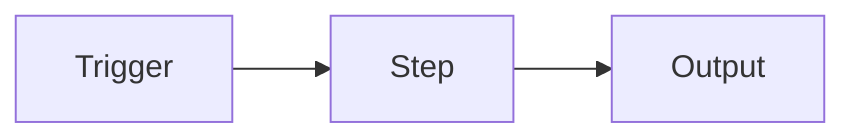

# <Workflow name>

One or two sentences: the problem solved and the outcome.

## Architecture



| Node | Purpose |
| --- | --- |
| ... | ... |

## Credentials needed

| Credential type | Used by |
| --- | --- |
| ... | ... |

## Import and run

1. Import `workflow.json`.
2. Select your own credentials and replace `YOUR_...` placeholders.
3. Send the sample request below.

## Sample input and output

```json
{}
```

## Status: tested vs not tested

- Tested: ...
- Not tested: ...

## Limitations and next improvements

- ...
