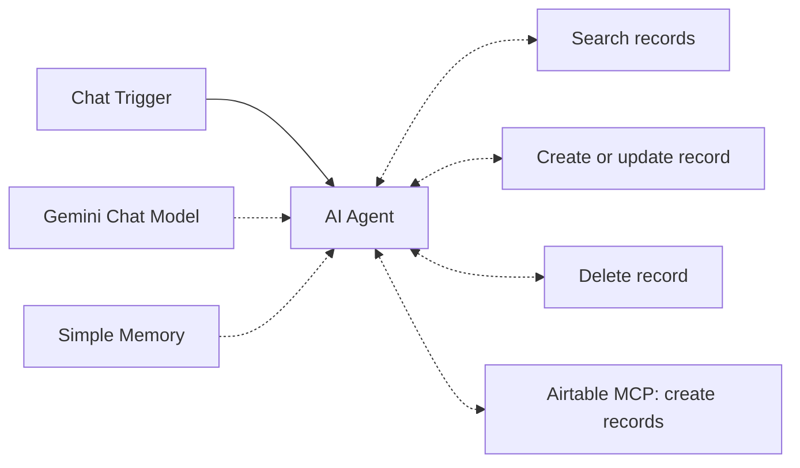

# Airtable AI Agent

A chat agent that manages a Team Members table in Airtable: it can find, add, update and delete records from plain-language requests.

## Architecture

| Node | Purpose |
| --- | --- |
| When chat message received | Chat entry point |
| AI Agent | Orchestrates tools, `maxIterations: 25` |
| Gemini Chat Model | Language model (retry on fail) |
| Simple Memory | Conversation context |
| Search / Upsert / Delete tools | Airtable Tool nodes with `$fromAI` parameters |
| Airtable MCP | Schema lookup and bulk record creation |

**Prompt design worth noting:** the system prompt pre-loads base, table and field ids so the agent skips schema discovery, enforces **one tool call per step**, requires record ids (`rec...`) for updates and deletes, and forbids repeating identical calls. These rules came from agent loops observed while debugging.

## Credentials needed

| Type | Used by |
| --- | --- |
| Google Gemini (PaLM) API | Chat model |
| Airtable Personal Access Token | Search, upsert, delete tools |
| Airtable MCP OAuth | Airtable MCP node |

## Import and run

1. Import `workflow.json`.
2. Replace `YOUR_BASE_ID`, `YOUR_TEAM_MEMBERS_TABLE_ID` and the other `YOUR_...` ids (in the system prompt **and** the tool nodes) with your own.
3. Open the chat and try: `Add Jane Doe and show me all team members`.

## Status

- Built and used by the author on a personal Airtable base; not re-tested after sanitizing.
- The `@n8n/mcp-registry.airtable` node may not exist on every n8n version; if import fails, delete that node and use only the three Airtable tool nodes.

## Limitations and next improvements

- The delete tool is powerful. Add a confirmation step (human-in-the-loop) before deleting.
- Upsert maps only Name and Email; extend the column mapping for Role and Department.
- Memory has no session isolation beyond n8n defaults.
