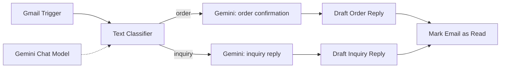

# Email Triage and Draft Replies (Gemini)

Polls Gmail every minute, classifies each email as an **order** or an **inquiry**, asks Gemini to write a suitable reply, saves it as a **Gmail draft** in the same thread, and marks the email as read. Nothing is sent automatically.

## Architecture

| Node | Purpose |
| --- | --- |
| Gmail Trigger | Polls every minute |
| Text Classifier | Two categories, uses the email snippet |
| Message a model / Reply to Inquiry | Gemini writes replies using placeholders instead of inventing facts |
| Draft nodes | Create a draft in the original thread, addressed to the sender |
| Mark Email as Read | Prevents reprocessing |

Design choices: drafts instead of sends (human review), placeholders for unknown details, retries (5 tries, 5s wait) on model calls.

## Credentials needed

| Type | Used by |
| --- | --- |
| Gmail OAuth2 | Trigger, drafts, mark as read |
| Google Gemini (PaLM) API | Classifier and reply generation |

## Import and run

1. Import, then select your Gmail and Gemini credentials.
2. Check the model id in both Gemini nodes against the models available to your key.
3. Send yourself an email such as "I'd like to place a new order for 3 chairs", wait a minute, and check your Gmail drafts.

## Status

- Built by the author; not re-tested after sanitizing.
- Cleaned vs live version: a trailing space in the `inquiry` category name was removed.

## Limitations and next improvements

- The classifier only sees the **snippet**, not the full body.
- Only two categories; anything else is forced into one of them. Add an `other` category that skips drafting.
- The trigger has no label filter, so it reads every incoming email.
