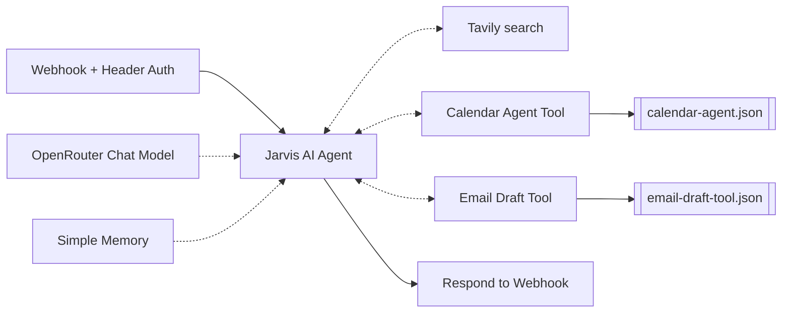

# Jarvis Assistant (orchestrator + sub-workflows)

A short-answer assistant, designed for voice front-ends, that receives a request over a webhook and delegates to specialist tools: web search, a Google Calendar agent, and a Gmail draft tool.

## Architecture



| File | Role |
| --- | --- |
| `orchestrator.json` | Webhook, persona prompt (1-3 sentence replies), memory, three tools |
| `calendar-agent.json` | Sub-workflow with its own agent and 4 Calendar tools (create, update, delete, list) |
| `email-draft-tool.json` | Sub-workflow that creates a Gmail draft from `subject` and `body` |

Design choices: one agent per domain (keeps tool lists small), `callerPolicy: workflowsFromAList` on sub-workflows so only the orchestrator can call them, drafts instead of sends, and update/delete require an exact `eventId` found with the list tool first.

## Credentials needed

| Type | Used by |
| --- | --- |
| Header Auth | Orchestrator webhook |
| OpenRouter | Both agents |
| Tavily API | Search tool |
| Google Calendar OAuth2 | Calendar agent |
| Gmail OAuth2 | Email draft tool |

## Import and run

1. Import `calendar-agent.json` and `email-draft-tool.json` **first**; note their workflow ids.
2. Import `orchestrator.json`; set the two tool nodes' workflow ids (`CALENDAR_WORKFLOW_ID`, `EMAIL_DRAFT_WORKFLOW_ID`).
3. In both sub-workflows' settings, replace `ORCHESTRATOR_WORKFLOW_ID` with the orchestrator's id, and replace `YOUR_CALENDAR_EMAIL` in the calendar nodes.
4. Test:

```bash
curl -X POST "https://YOUR-INSTANCE.app.n8n.cloud/webhook/jarvis" \
  -H "Content-Type: application/json" -H "X-API-Key: YOUR_SECRET" -H "x-session-id: demo" \
  -d '{"query": "Schedule a team sync tomorrow at 3pm"}'
```

## Status

- Built by the author; not re-tested after sanitizing.
- Cleaned vs live version: a disabled duplicate calendar tool was removed, session keys changed (`x-session-id` header in the orchestrator, a fixed key in the calendar agent), and Header Auth added.

## Limitations and next improvements

- `openrouter/free` models can be rate-limited and weak at tool calling; use a stronger tool-calling model for reliability.
- The calendar agent's memory uses one shared session key, so users share context.
- No confirmation before deleting calendar events.
