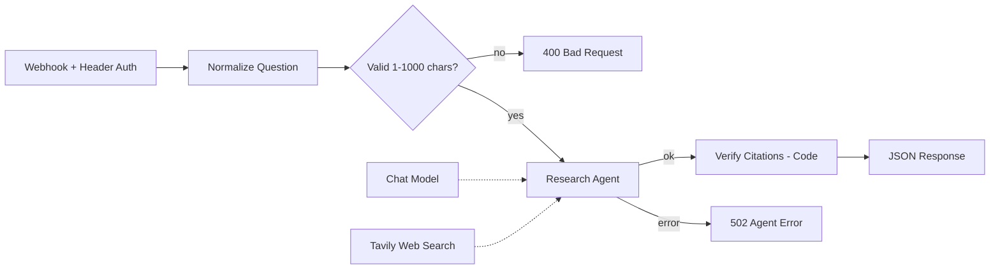

# Research Agent (Webhook)

Send a question to a webhook; an AI agent decides to search the web with Tavily, answers using only what it found, and the workflow **verifies every citation** before responding. Fake or unretrieved sources are removed and flagged.

## Architecture



| Node | Purpose |
| --- | --- |
| Research Question Webhook | `POST /research-agent`, Header Auth |
| Normalize Question | Collapses whitespace, reads `body.question` |
| Question Is Valid? | Rejects empty or oversized input |
| Research Agent | Tool-calling agent, `forceToolCallOnFirstIteration`, max 5 iterations, returns intermediate steps |
| Tavily Web Search | Search tool (basic depth, 5 results, no Tavily-generated answer) |
| Verify Citations | Maps `[[url]]` markers to retrieved results, dedupes URLs (strips `utm_*`, trailing slash), renumbers to `[1]`, `[2]`, drops unknown URLs |
| Respond nodes | 200 answer, 400 bad input, 502 failures |

**Design idea:** the model cites by URL, and code (not the model) decides which citations are real. This mirrors the Python/Streamlit version of the same agent.

## Credentials needed

| Type | Used by |
| --- | --- |
| Header Auth | Webhook |
| Anthropic (or swap in any **tool-calling** chat model) | Chat Model |
| Tavily API | Tavily Web Search |

## Import and run

```bash
curl -X POST "https://YOUR-INSTANCE.app.n8n.cloud/webhook/research-agent" \
  -H "Content-Type: application/json" -H "X-API-Key: YOUR_SECRET" \
  -d '{"question": "What are the latest developments in solid-state batteries?"}'
```

Response shape: `status` (`ok`, `no_sources`, `search_failed`), `answer`, `sources[]`, `warnings`, `events`, `searches_completed`, `retrieved_count`, `disclaimer`.

## Status

- Tested: the Verify Citations logic with pinned agent output (valid URL with `utm_` param, duplicate URL, fabricated URL removed with warning); the error branch.
- Not tested: a complete live run with a tool-calling model and Tavily after the final changes. Use a **chat/tool-calling** model; speech or text-to-speech models will not work.

## Limitations and next improvements

- The "max 3 searches" rule is in the prompt only; `maxIterations` is the hard limit.
- Search text reaches the model unescaped (the Python version escapes it); the prompt tells it to ignore embedded instructions.
- Citation check proves a URL was retrieved, not that the sentence paraphrases it perfectly.
